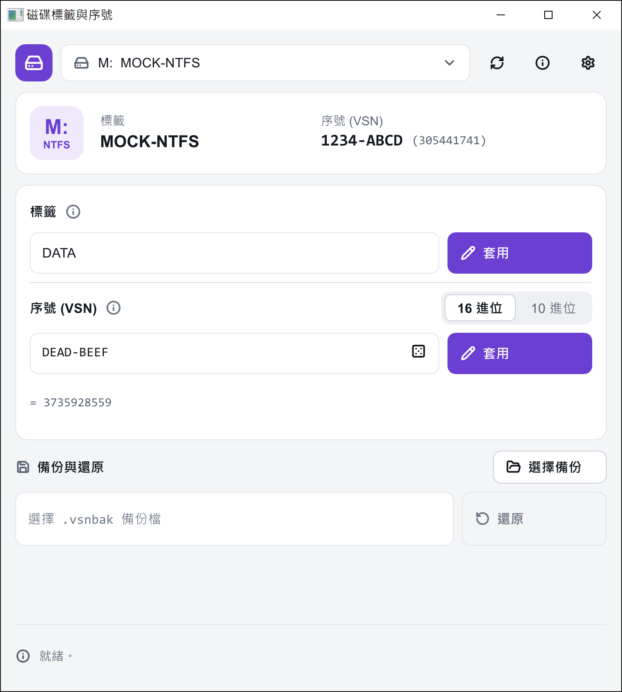

  

**繁體中文** · [简体中文](docs/readme/README_zh-CN.md) · [English](docs/readme/README_en.md)

# 磁碟標籤與磁碟區序號工具

### Windows 磁碟標籤與 Volume Serial Number 備份、驗證與還原

---

## 📖 軟體簡介

管理可卸除磁碟或測試磁碟的磁碟標籤與 Volume Serial Number（VSN）。工具提供圖形介面與命令列操作，並可建立 **VSNBAK2** 備份、驗證備份內容，再依安全檢查還原。

⚠️ 本工具會寫入磁碟區開機磁區，請先備份重要資料並確認目標磁碟；請勿對系統磁碟或含重要資料的磁碟試用。

---

## 📸 軟體操作畫面

  

---

## 📌 目前狀態

> 開發中（0.1.0）。**操作具破壞性**，會寫入磁碟區開機磁區；尚未發布可下載的執行檔。

---

## ✨ 功能介紹

### 1. 💽 管理磁碟標籤與序號
- 提供磁碟區標籤與 VSN 操作入口，可用 GUI 或 CLI 執行。

### 2. 🧾 VSNBAK2 備份格式
- 備份包含 SHA-256 驗證資訊與目標磁碟識別資料，可先執行唯讀驗證。

### 3. 🔍 還原前比對磁碟狀態
- 還原流程檢查卷 GUID、大小、開機配置及目前磁區內容，並拒絕系統磁碟與分頁檔磁碟。

### 4. ↩️ 寫入後驗證與回復回報
- 寫入後讀回驗證；若失敗，會回報回復結果。相同備份重複還原不會重複寫入。

---

## 💻 支援範圍與限制

| 環境／項目 | 已記錄狀態 | 範圍說明 |
| :--- | :--- | :--- |
| Windows 10 x64 CLI | NTFS、FAT32、exFAT 已在拋棄式 VHDX 測試 | 涵蓋備份、驗證、還原與重複還原檢查 |
| Windows 10 x64 GUI | NTFS GUI 還原已測試 | GUI 的 FAT32／exFAT 還原尚未執行驗收 |
| x86 執行檔 | 已建置，最終版尚未執行 | 不可將成功建置視為已驗證可執行 |
| Windows 7 | 尚未驗證 | 目前有 combase.dll 匯入相容性疑慮 |
| Windows XP／Vista | 不支援 | 不是本工具的目標系統 |

---

## 🚀 使用流程

1. 確認目標是可卸除或測試磁碟，核對磁碟代號、標籤與容量；先備份磁碟上的重要檔案。
2. 變更前先建立 VSNBAK2 備份，並以唯讀驗證命令檢查備份檔。
3. 確認目標磁碟與備份相符後才進行還原，逐字確認操作提示並等待完成回報。
4. 完成後確認磁碟可正常掛載並讀取資料；任何錯誤都應停止後續寫入。

---

## 📦 下載與使用說明

目前尚未發布可下載的執行檔；發布後將提供於本專案的 [Releases 頁面](https://github.com/robert820/volume-label-serial-modifier/releases)。

---

## 🖥️ 系統與環境需求

- **作業系統**：Windows 10 x64（已記錄驗證）；Windows 7 尚未驗證；XP／Vista 不支援
- **執行權限**：修改序號需要以系統管理員身分執行
- **執行環境**：原生 Rust 執行檔，無須額外安裝 .NET 或 VC++ 可轉發套件

---

## ❓ 常見問題 (FAQ)

<b>可以在 C 槽或 Windows 系統磁碟使用嗎？</b>

不可以。還原安全檢查會拒絕系統磁碟與分頁檔磁碟。請只在可拋棄測試磁碟或已備份的目標磁碟操作。

<b>Windows 7 或 32 位元版本已經確認可用嗎？</b>

尚未。Windows 7 尚未驗證；最終 x86 執行檔亦尚未完成執行驗收。

---

## 💬 問題反饋與支援

- 🐛 **錯誤回報與功能建議**：歡迎至本專案的 [Issues 頁面](https://github.com/robert820/volume-label-serial-modifier/issues) 提出。
- 🌐 **得翼科技官方網站**：[https://blog.dei3c.com](https://blog.dei3c.com)
- 📧 **技術支援與商務洽詢**：請透過官方網站聯繫我們。

---

## 📄 授權條款 (License)

本軟體採用專有免費軟體授權（Proprietary Freeware），完整授權規範、使用條款與免責聲明請參閱 [LICENSE](LICENSE) 檔案。

- 第三方元件：本軟體使用 Slint（Royalty-Free License）、YY-Thunks（MIT）與多個開源 Rust 套件，授權聲明請見 [THIRD_PARTY_NOTICES.md](THIRD_PARTY_NOTICES.md)。

<a href="https://slint.dev"><picture>
  <source media="(prefers-color-scheme: dark)" srcset="https://raw.githubusercontent.com/slint-ui/slint/master/logo/MadeWithSlint-logo-dark.png">
  
</picture></a>
