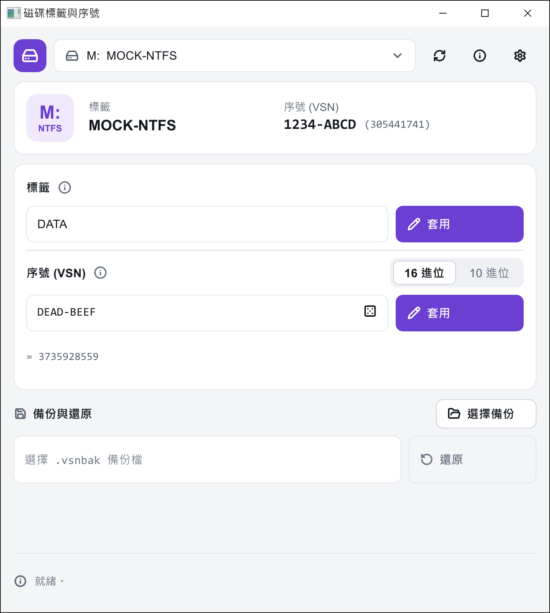

  

[繁體中文](../../README.md) · [简体中文](README_zh-CN.md) · **English**

# Volume Label & Serial Modifier

### Backup, verify and restore Windows volume labels and Volume Serial Numbers

---

## 📖 Overview

Manage the volume label and Volume Serial Number (VSN) of removable or test disks. The tool offers a GUI and a command line, can create **VSNBAK2** backups, verify their contents, and restore them after safety checks.

⚠️ This tool writes to the volume boot sector. Back up important data first and double-check the target disk; do not try it on a system disk or a disk holding important data.

---

## 📸 Screenshot

  

---

## 📌 Current status

> In development (0.1.0). **Destructive operation**: it writes to the volume boot sector. No downloadable build has been released yet.

---

## ✨ Features

### 1. 💽 Manage label and serial
- Entry points for the volume label and VSN, usable from the GUI or the CLI.

### 2. 🧾 VSNBAK2 backup format
- Backups carry SHA-256 verification data and target-disk identification data, and can be verified read-only first.

### 3. 🔍 Disk-state checks before restore
- The restore flow checks the volume GUID, size, boot configuration and current sector contents, and refuses system disks and page-file disks.

### 4. ↩️ Read-back verification and rollback report
- After writing, the result is read back and verified; on failure the rollback result is reported. Restoring the same backup twice does not write twice.

---

## 💻 Scope & limitations

| Environment / item | Recorded status | Scope |
| :--- | :--- | :--- |
| Windows 10 x64 CLI | NTFS, FAT32, exFAT tested on disposable VHDX | Covers backup, verify, restore and repeat-restore checks |
| Windows 10 x64 GUI | NTFS GUI restore tested | GUI FAT32 / exFAT restore not yet validated |
| x86 executable | Built; final build not yet run | A successful build must not be taken as verified to run |
| Windows 7 | Not validated | There is a known combase.dll import-compatibility concern |
| Windows XP / Vista | Not supported | Not a target system of this tool |

---

## 🚀 Workflow

1. Make sure the target is a removable or test disk; check its drive letter, label and capacity, and back up its important files first.
2. Create a VSNBAK2 backup before any change and check it with the read-only verify command.
3. Restore only after confirming that the target disk matches the backup; type the confirmation prompts exactly and wait for the completion report.
4. Afterwards confirm the disk mounts and reads normally; stop all further writes on any error.

---

## 📦 Download

No downloadable build has been released yet. Once released, it will be provided on the [Releases page](https://github.com/robert820/volume-label-serial-modifier/releases).

---

## 🖥️ Requirements

- **OS**: Windows 10 x64 (validated); Windows 7 not validated; XP / Vista unsupported
- **Privileges**: changing the serial requires running as administrator
- **Runtime**: native Rust executable; no .NET or VC++ redistributable required

---

## ❓ FAQ

<b>Can I use it on the C: drive or a Windows system disk?</b>

No. The restore safety checks refuse system disks and page-file disks. Use it only on disposable test disks or backed-up target disks.

<b>Is Windows 7 or the 32-bit build confirmed to work?</b>

Not yet. Windows 7 is not validated, and the final x86 executable has not completed runtime validation.

---

## 💬 Feedback & support

- 🐛 **Bug reports & feature requests**: please use the [Issues page](https://github.com/robert820/volume-label-serial-modifier/issues).
- 🌐 **DEI Tech official website**: [https://blog.dei3c.com](https://blog.dei3c.com)
- 📧 **Support & business inquiries**: please contact us through the official website.

---

## 📄 License

This software is released under a Proprietary Freeware license. See the [LICENSE](../../LICENSE) file for the full terms and disclaimers.

- Third-party components: this software uses Slint (Royalty-Free License), YY-Thunks (MIT) and several open-source Rust crates; see [THIRD_PARTY_NOTICES.md](../../THIRD_PARTY_NOTICES.md) for the notices.

<a href="https://slint.dev"><picture>
  <source media="(prefers-color-scheme: dark)" srcset="https://raw.githubusercontent.com/slint-ui/slint/master/logo/MadeWithSlint-logo-dark.png">
  
</picture></a>
