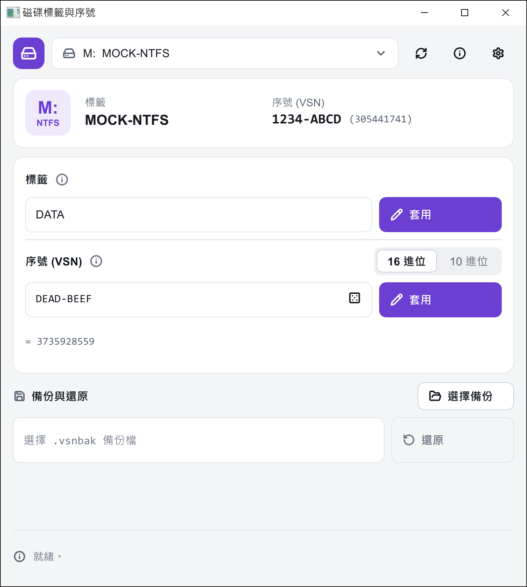

  

[繁体中文](../../README.md) · **简体中文** · [English](README_en.md)

# 磁盘标签与磁盘区序号工具

### Windows 磁盘标签与 Volume Serial Number 备份、验证与还原

---

## 📖 软件简介

管理可卸除磁盘或测试磁盘的磁盘标签与 Volume Serial Number（VSN）。工具提供图形接口与命令行操作，并可创建 **VSNBAK2** 备份、验证备份内容，再依安全检查还原。

⚠️ 本工具会写入磁盘区开机磁区，请先备份重要数据并确认目标磁盘；请勿对系统磁盘或含重要数据的磁盘试用。

---

## 📸 软件操作画面

  

---

## 📌 目前状态

> 开发中（0.1.0）。**操作具破坏性**，会写入磁盘区开机磁区；尚未发布可下载的运行档。

---

## ✨ 功能介绍

### 1. 💽 管理磁盘标签与序号
- 提供磁盘区标签与 VSN 操作入口，可用 GUI 或 CLI 运行。

### 2. 🧾 VSNBAK2 备份格式
- 备份包含 SHA-256 验证信息与目标磁盘识别数据，可先运行唯读验证。

### 3. 🔍 还原前比对磁盘状态
- 还原流程检查卷 GUID、大小、开机配置及目前磁区内容，并拒绝系统磁盘与分页档磁盘。

### 4. ↩️ 写入后验证与回复回报
- 写入后读回验证；若失败，会回报回复结果。相同备份重复还原不会重复写入。

---

## 💻 支持范围与限制

| 环境／项目 | 已记录状态 | 范围说明 |
| :--- | :--- | :--- |
| Windows 10 x64 CLI | NTFS、FAT32、exFAT 已在抛弃式 VHDX 测试 | 涵盖备份、验证、还原与重复还原检查 |
| Windows 10 x64 GUI | NTFS GUI 还原已测试 | GUI 的 FAT32／exFAT 还原尚未运行验收 |
| x86 运行档 | 已建置，最终版尚未运行 | 不可将成功建置视为已验证可运行 |
| Windows 7 | 尚未验证 | 目前有 combase.dll 导入兼容性疑虑 |
| Windows XP／Vista | 不支持 | 不是本工具的目标系统 |

---

## 🚀 使用流程

1. 确认目标是可卸除或测试磁盘，核对磁盘代号、标签与容量；先备份磁盘上的重要文件。
2. 变更前先创建 VSNBAK2 备份，并以唯读验证命令检查备份档。
3. 确认目标磁盘与备份相符后才进行还原，逐字确认操作提示并等待完成回报。
4. 完成后确认磁盘可正常挂载并读取数据；任何错误都应停止后续写入。

---

## 📦 下载与使用说明

目前尚未发布可下载的运行档；发布后将提供于本项目的 [Releases 页面](https://github.com/robert820/volume-label-serial-modifier/releases)。

---

## 🖥️ 系统与环境需求

- **操作系统**：Windows 10 x64（已记录验证）；Windows 7 尚未验证；XP／Vista 不支持
- **运行权限**：修改序号需要以系统管理员身分运行
- **运行环境**：原生 Rust 运行档，无须额外安装 .NET 或 VC++ 可转发套件

---

## ❓ 常见问题 (FAQ)

<b>可以在 C 槽或 Windows 系统磁盘使用吗？</b>

不可以。还原安全检查会拒绝系统磁盘与分页档磁盘。请只在可抛弃测试磁盘或已备份的目标磁盘操作。

<b>Windows 7 或 32 比特版本已经确认可用吗？</b>

尚未。Windows 7 尚未验证；最终 x86 运行档亦尚未完成运行验收。

---

## 💬 问题反馈与支持

- 🐛 **错误回报与功能建议**：欢迎至本项目的 [Issues 页面](https://github.com/robert820/volume-label-serial-modifier/issues) 提出。
- 🌐 **得翼科技官方网站**：[https://blog.dei3c.com](https://blog.dei3c.com)
- 📧 **技术支持与商务洽询**：请通过官方网站联系我们。

---

## 📄 授权条款 (License)

本软件采用专有免费软件授权（Proprietary Freeware），完整授权规范、使用条款与免责声明请参阅 [LICENSE](../../LICENSE) 文件。

- 第三方组件：本软件使用 Slint（Royalty-Free License）、YY-Thunks（MIT）与多个开源 Rust 套件，授权声明请见 [THIRD_PARTY_NOTICES.md](../../THIRD_PARTY_NOTICES.md)。

<a href="https://slint.dev"><picture>
  <source media="(prefers-color-scheme: dark)" srcset="https://raw.githubusercontent.com/slint-ui/slint/master/logo/MadeWithSlint-logo-dark.png">
  
</picture></a>
